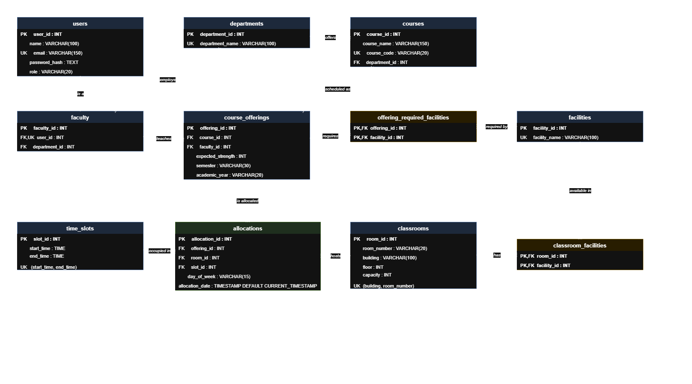
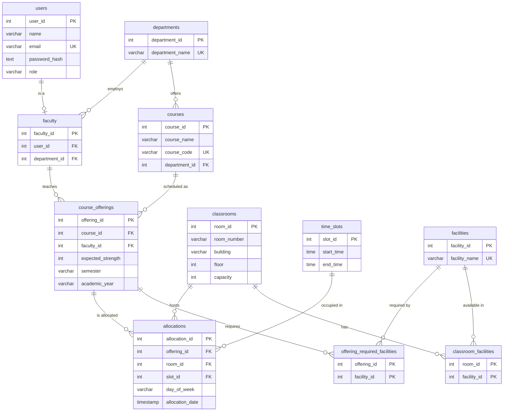

# Relational Schema — University Classroom Allocation System

**DBMS:** PostgreSQL  **Source:** `database/schema.sql`
**Related:** [ER Diagram (PNG)](ER_Diagram.png) · [ER Diagram (draw.io)](ER_Diagram.drawio) · [Data Dictionary](Data_Dictionary.md)

Notation: <u>underlined</u> = primary key, *italic* = foreign key, `{UK}` = unique key.
Composite PKs are written <u>(A, B)</u>.

---

## 1. Relations

| # | Relation |
|---|----------|
| 1 | **departments**(<u>department_id</u>, department_name `{UK}`) |
| 2 | **users**(<u>user_id</u>, name, email `{UK}`, password_hash, role) |
| 3 | **faculty**(<u>faculty_id</u>, *user_id* `{UK}`, *department_id*) |
| 4 | **classrooms**(<u>room_id</u>, room_number, building, floor, capacity) — `{UK}` (building, room_number) |
| 5 | **facilities**(<u>facility_id</u>, facility_name `{UK}`) |
| 6 | **classroom_facilities**(<u>*room_id*, *facility_id*</u>) |
| 7 | **courses**(<u>course_id</u>, course_name, course_code `{UK}`, *department_id*) |
| 8 | **course_offerings**(<u>offering_id</u>, *course_id*, *faculty_id*, expected_strength, semester, academic_year) |
| 9 | **offering_required_facilities**(<u>*offering_id*, *facility_id*</u>) |
| 10 | **time_slots**(<u>slot_id</u>, start_time, end_time) — `{UK}` (start_time, end_time) |
| 11 | **allocations**(<u>allocation_id</u>, *offering_id*, *room_id*, *slot_id*, day_of_week, allocation_date) — `{UK}` (room_id, slot_id, day_of_week), `{UK}` (offering_id, slot_id, day_of_week) |

---

## 2. Foreign Keys (Referential Integrity)

| Child relation | FK attribute(s) | Parent relation | Parent key | On delete |
|---|---|---|---|---|
| faculty | user_id | users | user_id | NO ACTION |
| faculty | department_id | departments | department_id | NO ACTION |
| classroom_facilities | room_id | classrooms | room_id | **CASCADE** |
| classroom_facilities | facility_id | facilities | facility_id | NO ACTION |
| courses | department_id | departments | department_id | NO ACTION |
| course_offerings | course_id | courses | course_id | NO ACTION |
| course_offerings | faculty_id | faculty | faculty_id | NO ACTION |
| offering_required_facilities | offering_id | course_offerings | offering_id | **CASCADE** |
| offering_required_facilities | facility_id | facilities | facility_id | NO ACTION |
| allocations | offering_id | course_offerings | offering_id | NO ACTION |
| allocations | room_id | classrooms | room_id | NO ACTION |
| allocations | slot_id | time_slots | slot_id | NO ACTION |

`NO ACTION` (PostgreSQL default) means a parent row cannot be deleted while child rows still reference it.

---

## 3. Mapping from the ER Model

| ER construct | Relationship | Mapping rule applied |
|---|---|---|
| users — faculty | 1 : 0..1 | FK `faculty.user_id` made `UNIQUE NOT NULL` (one-to-one) |
| departments — faculty | 1 : N | FK on the N side (`faculty.department_id`) |
| departments — courses | 1 : N | FK on the N side (`courses.department_id`) |
| courses — course_offerings | 1 : N | FK on the N side (`course_offerings.course_id`) |
| faculty — course_offerings | 1 : N | FK on the N side (`course_offerings.faculty_id`) |
| classrooms — facilities | M : N | Resolved into **classroom_facilities** with composite PK |
| course_offerings — facilities | M : N | Resolved into **offering_required_facilities** with composite PK |
| course_offerings, classrooms, time_slots — allocations | 1 : N each | Three FKs in **allocations** (ternary association materialised as an entity) |

`allocations` is the central transaction relation: one row says *"this course offering is taught in this room, in this time slot, on this weekday"*.

---

## 4. Integrity Constraints

### 4.1 Domain / CHECK constraints
| Relation | Constraint |
|---|---|
| users | `role IN ('ADMIN', 'FACULTY')` |
| classrooms | `floor >= 0`, `capacity > 0` |
| course_offerings | `expected_strength > 0` |
| time_slots | `end_time > start_time` |
| allocations | `day_of_week IN ('Monday','Tuesday','Wednesday','Thursday','Friday','Saturday')` |

### 4.2 Candidate keys beyond the primary key
| Relation | Candidate key |
|---|---|
| departments | department_name |
| users | email |
| faculty | user_id |
| classrooms | (building, room_number) |
| facilities | facility_name |
| courses | course_code |
| time_slots | (start_time, end_time) |
| allocations | (room_id, slot_id, day_of_week), (offering_id, slot_id, day_of_week) |

### 4.3 Business rules enforced by trigger `trg_validate_classroom_allocation`
Declarative constraints cannot express rules that span several tables, so a `BEFORE INSERT OR UPDATE` trigger on `allocations` enforces:

1. The course offering, classroom and time slot must exist.
2. **Capacity:** `course_offerings.expected_strength <= classrooms.capacity`.
3. **Facilities:** every row in `offering_required_facilities` for the offering must have a matching row in `classroom_facilities` for the room.
4. **Room clash:** no other allocation in the same room on the same day may have an *overlapping* time range.
5. **Faculty clash:** the same faculty member cannot be allocated to two overlapping time ranges on the same day.
6. **Concurrency:** `pg_advisory_xact_lock` serialises allocation writes so two simultaneous transactions cannot both pass checks 4 and 5.

The `UNIQUE` constraints on `allocations` catch exact duplicates; the trigger additionally catches *partial overlaps*.

---

## 5. Normalization

All relations are in **3NF and BCNF**. Every non-trivial functional dependency has a candidate key as its determinant.

| Relation | Functional dependencies | Highest NF |
|---|---|---|
| departments | department_id → department_name; department_name → department_id | BCNF |
| users | user_id → name, email, password_hash, role; email → user_id | BCNF |
| faculty | faculty_id → user_id, department_id; user_id → faculty_id | BCNF |
| classrooms | room_id → room_number, building, floor, capacity; (building, room_number) → room_id | BCNF |
| facilities | facility_id → facility_name; facility_name → facility_id | BCNF |
| classroom_facilities | (room_id, facility_id) → ∅ (all-key) | BCNF |
| courses | course_id → course_name, course_code, department_id; course_code → course_id | BCNF |
| course_offerings | offering_id → course_id, faculty_id, expected_strength, semester, academic_year | BCNF |
| offering_required_facilities | (offering_id, facility_id) → ∅ (all-key) | BCNF |
| time_slots | slot_id → start_time, end_time; (start_time, end_time) → slot_id | BCNF |
| allocations | allocation_id → offering_id, room_id, slot_id, day_of_week, allocation_date; (room_id, slot_id, day_of_week) → allocation_id; (offering_id, slot_id, day_of_week) → allocation_id | BCNF |

**Why the design is normalized**

- **1NF:** all attributes are atomic. Multi-valued facilities are split into the two junction tables instead of a comma-separated column.
- **2NF:** the only composite keys are in the all-key junction tables, so no partial dependencies exist.
- **3NF / BCNF:** faculty name and email live only in `users`; department names only in `departments`; room capacity only in `classrooms`. `allocations` stores IDs rather than copies of course, room or time data, so there are no transitive dependencies.

---

## 6. Derived Objects

| Object | Type | Purpose |
|---|---|---|
| `classroom_timetable` | View | Joins allocations, offerings, courses, faculty/users, classrooms and time_slots into a readable timetable |
| `classroom_utilization` | View | Per room: number of allocations and average `expected_strength / capacity` as a percentage |
| `allocate_classroom(offering, room, slot, day)` | Stored procedure | Inserts an allocation; validation is performed by the trigger |
| `get_classroom_utilization(room_id)` | Function | Returns average utilization % for one room |
| `validate_classroom_allocation()` | Trigger function | Implements the business rules in §4.3 |

### Indexes (beyond those implied by PK/UK)
| Index | Table | Columns |
|---|---|---|
| idx_allocations_room_day_slot | allocations | (room_id, day_of_week, slot_id) |
| idx_allocations_offering | allocations | (offering_id) |
| idx_allocations_slot | allocations | (slot_id) |
| idx_course_offerings_faculty | course_offerings | (faculty_id) |
| idx_courses_department | courses | (department_id) |
| idx_classrooms_capacity | classrooms | (capacity) |

---

## 7. Mermaid ER Diagram (renders on GitHub)

